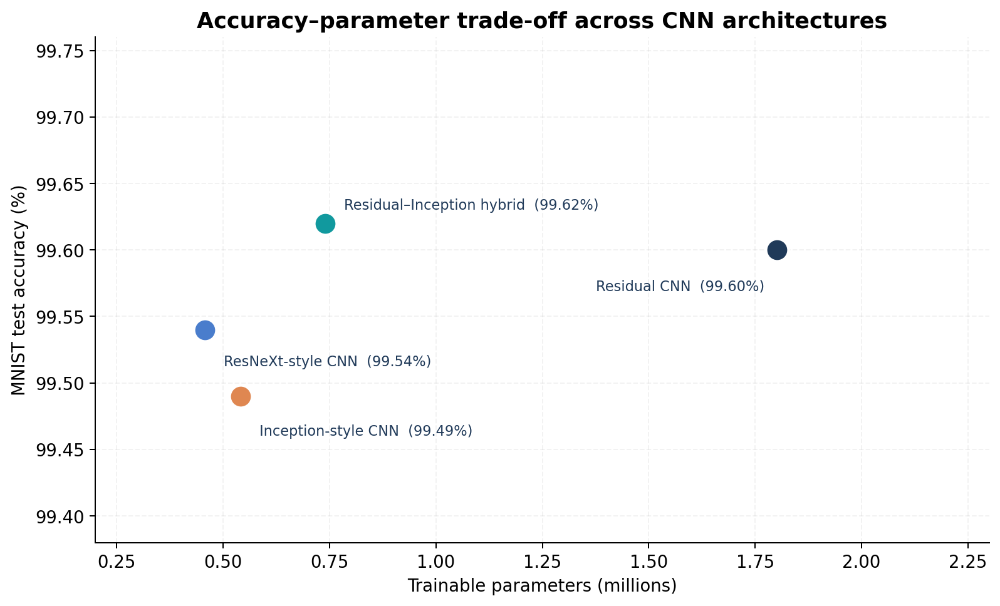
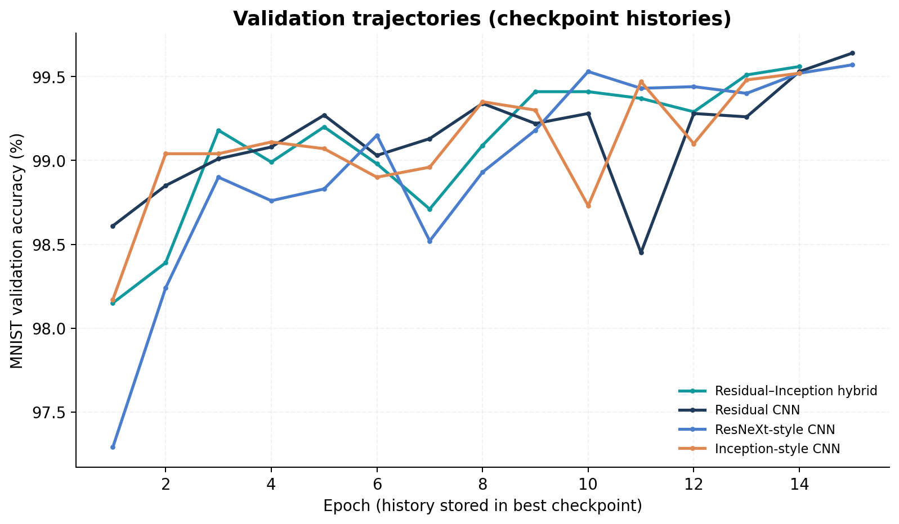
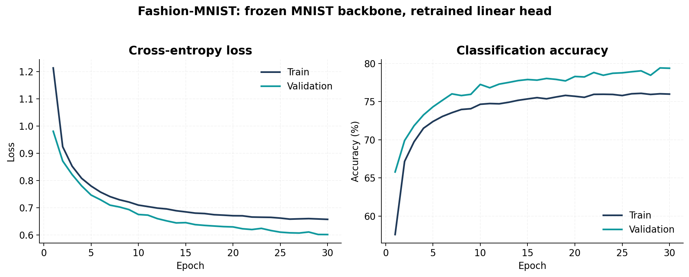
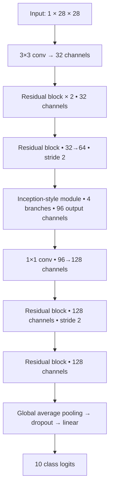

# CNN Architecture Study: Residual Learning, Multi-Scale Features, and Transfer

**A controlled PyTorch comparison of residual, Inception-style, ResNeXt-style, and hybrid convolutional networks on MNIST, followed by a frozen-backbone transfer experiment on Fashion-MNIST.**

This project asks two related questions:

1. **Architectural trade-offs:** How do skip connections, parallel multi-scale branches, and grouped convolutions compare in accuracy and parameter count when trained within the same MNIST pipeline?
2. **Feature transfer:** What happens when features learned for handwritten-digit recognition are frozen and only a classification head is retrained for a different visual domain?

The focus is on **implementing and analyzing established architectural ideas**, not claiming a new neural-network family or state-of-the-art performance.

> **Results at a glance:** The custom residual–Inception hybrid achieved **99.62% MNIST test accuracy** with **739,370 parameters**. A conventional residual baseline reached **99.60%** with **1,801,706 parameters**. Head-only adaptation of the MNIST-trained residual network to Fashion-MNIST reached **78.86% test accuracy**. These are results from the supplied experiment records; the original MNIST dataset file was not included, so independent test-set re-evaluation was not possible.

## 1. Results

### MNIST architecture comparison

| Architecture | Trainable parameters | Best epoch | Best validation loss | Test loss | Test accuracy |
| :-- | --: | --: | --: | --: | --: |
| **Residual–Inception hybrid (custom)** | **739,370** | 14 | 0.01826 | 0.01301 | **99.62%** |
| Residual CNN | 1,801,706 | 15 | **0.01795** | 0.01423 | 99.60% |
| ResNeXt-style CNN | **457,450** | 15 | 0.01893 | 0.01608 | 99.54% |
| Inception-style CNN | 541,450 | 14 | 0.01990 | 0.01934 | 99.49% |

All four models were evaluated with the same project pipeline and nominal training hyperparameters. Their **best checkpoints were selected by validation cross-entropy loss**, not test-set accuracy.



**Interpretation.** Relative to the residual baseline, the custom hybrid has approximately **59% fewer parameters**, while its recorded test accuracy is **0.02 percentage points higher**. That tiny accuracy gap should not be read as a statistically established advantage: the archive contains one reported run per model, without uncertainty intervals or repeated-seed experiments. The ResNeXt-style model is the smallest in this comparison, but not the most accurate.



*The plotted MNIST histories come from the saved best checkpoints. Consequently, each trajectory stops at its checkpoint-selection epoch and does not necessarily show every epoch originally trained.*

### Fashion-MNIST: frozen-backbone adaptation

| Transfer setting | Trainable component | Best epoch | Best validation loss | Test loss | Test accuracy |
| :-- | :-- | --: | --: | --: | --: |
| MNIST-pretrained residual CNN → Fashion-MNIST | Reinitialized classification head only | 30 | 0.60144 | 0.60230 | **78.86%** |



This experiment is best described as **head-only transfer** or **linear probing**: the feature extractor remains frozen, while the final linear classifier learns the new labels. It is **not** full-network fine-tuning. No scratch-trained Fashion-MNIST control or full fine-tuning baseline was supplied, so the result does **not** establish a benefit from transfer learning over those alternatives.

## 2. Architectural designs

The four implementations are purpose-built, relatively compact CNNs inspired by established research; they are **not exact reproductions** of the full ImageNet-scale ResNet, Inception, or ResNeXt architectures.

| Model | Main architectural mechanism | Implementation |
| :-- | :-- | :-- |
| `TableResidualNet` | Two-convolution residual blocks with optional projection skips | `ResidualBlock` |
| `TableInceptionNet` | Parallel pooling, 1×1, 3×3, and stacked 3×3 paths | `InceptionFactorizedBlock` |
| `TableResNeXtNet` | Bottleneck residual blocks with grouped 3×3 convolution | `ResNeXtBlock` (4 groups by default) |
| `MNISTResInception` | Residual feature extraction, an Inception-style multi-branch stage, and a residual tail | `ResidualBlock` + `InceptionFactorizedBlock` |

All four architectures use convolution–batch-normalization–ReLU modules, a global-average-pooling classifier, and a final fully connected layer producing 10 logits. The hybrid uses **0.20 dropout** in the classification head; the three comparison models use **0.05** under the supplied configuration. This difference is relevant when interpreting the comparison as an architectural study.

### Residual learning

A residual block learns a transformation in addition to a skip path:

```math
\mathbf{y}=\mathrm{ReLU}\!\left(F(\mathbf{x};\boldsymbol{\theta})+P(\mathbf{x})\right).
```

Here, `F` denotes two convolution–batch-normalization transformations, and `P` is either the identity or a learned 1×1 projection used to align channels and/or spatial resolution. The implementation follows the central idea of [He et al., 2016](https://arxiv.org/abs/1512.03385).

### Multi-branch Inception-style processing

Each Inception-style block processes the same input through four parallel branches and concatenates the resulting features along the channel dimension:

```math
I(\mathbf{x})=\mathrm{Concat}\!\left[
B_{\mathrm{pool}}(\mathbf{x}),\;
B_{1\times1}(\mathbf{x}),\;
B_{3\times3}(\mathbf{x}),\;
B_{3\times3\rightarrow3\times3}(\mathbf{x})
\right].
```

The longer branch uses **two stacked 3×3 convolutions**, preceded by a 1×1 reduction; the pooling branch uses average pooling followed by a 1×1 projection. This is an Inception-*style* implementation motivated by the multi-scale feature-processing principle of [Szegedy et al., 2015](https://arxiv.org/abs/1409.4842) and convolution factorization discussed in [Szegedy et al., 2016](https://arxiv.org/abs/1512.00567).

### Grouped convolutions and ResNeXt-style cardinality

The grouped convolution in the ResNeXt-style bottleneck divides intermediate channels into independently convolved groups:

```math
\mathbf{x}=[\mathbf{x}_1,\ldots,\mathbf{x}_G],\qquad
\mathrm{GroupConv}(\mathbf{x})=
\mathrm{Concat}\!\left[W_1*\mathbf{x}_1,\ldots,W_G*\mathbf{x}_G\right].
```

The code uses a **1×1 reduction → grouped 3×3 convolution → 1×1 expansion** bottleneck inside a residual block. Its default cardinality is `G = 4`, based on the grouped-transformation idea in [Xie et al., 2017](https://arxiv.org/abs/1611.05431).

### Custom residual–Inception hybrid

The custom model intentionally combines residual feature extraction with a multi-scale aggregation stage:



The hybrid first learns spatial features through residual blocks, merges different receptive-field paths through its Inception module, and then refines the combined representation using additional residual blocks. This is a **designed combination of known components** whose measured parameter/accuracy trade-off is reported above.

## 3. Optimization and evaluation

For a batch of `N` labeled examples with `K = 10` classes, the training objective is multiclass cross-entropy applied to unnormalized logits:

```math
p_{i,k}=\frac{e^{z_{i,k}}}{\sum_{j=1}^{K}e^{z_{i,j}}},
\qquad
\mathcal{L}_{\mathrm{CE}}=-\frac{1}{N}\sum_{i=1}^{N}\log p_{i,y_i}.
```

The classification metric is the fraction of correctly predicted labels:

```math
\mathrm{Accuracy}=\frac{1}{N}\sum_{i=1}^{N}
\mathbf{1}\!\left[\arg\max_k z_{i,k}=y_i\right].
```

**Recorded MNIST training configuration** (`config/config.yaml`):

| Setting | Value |
| :-- | :-- |
| Dataset input | Single-channel 28×28 MNIST, supplied in `mnist.pkl.gz` |
| Optimizer | AdamW |
| Initial learning rate | 0.001 |
| Weight decay | 0.0001 |
| Batch size | 128 |
| Maximum epochs | 15 |
| Scheduler | `ReduceLROnPlateau`, factor 0.5, patience 2 |
| Model selection | Minimum validation cross-entropy |
| Experiment seed | `9` in the main configuration; the multi-model comparison resets seed to `42` per model |
| Acceleration | CUDA, then Apple MPS, otherwise CPU |

The original three-split `mnist.pkl.gz` is expected to contain `(images, labels)` for **train, validation, and test** in that order. Its precise sample order and preprocessing cannot be recovered from the provided archive. No data augmentation is implemented in the MNIST pipeline.

The Fashion-MNIST transfer experiment uses an MNIST-pretrained `TableResidualNet`, a **newly initialized output linear layer**, frozen backbone weights, and **frozen batch-normalization running statistics** (the backbone stays in evaluation mode). It uses 55,000 Fashion-MNIST training images, 5,000 held-out validation images selected with a seeded random split, the standard 10,000-image test set, batch size 256, AdamW, and up to 30 epochs. Fashion-MNIST inputs are normalized with mean `0.2860` and standard deviation `0.3530`, whereas the original MNIST loading path does not apply this transform. The **domain and input-normalization differences** complicate interpretation of transfer effectiveness.

## 4. Reproducibility

### Install

Python 3.10+ is recommended. Use mutually compatible versions of PyTorch and torchvision for your system.

```bash
python -m venv .venv
source .venv/bin/activate
pip install -r requirements.txt
```

On Windows, activate the environment with `.venv\Scripts\activate` instead.

### Prepare MNIST

**Option A — original experimental data:** If you have the original `mnist.pkl.gz`, place it in `data/dataset/mnist.pkl.gz`. This is the most faithful way to attempt to reproduce the saved measurements.

**Option B — compatible dataset creation:** Generate a new three-split pickle from the torchvision MNIST download:

```bash
python scripts/prepare_mnist.py
```

This produces 50,000 training, 10,000 validation, and 10,000 test examples; it scales pixels to `[0, 1]`. **Important:** this recreates the input format but may not recreate the *exact split/order/preprocessing* used to obtain the archived metrics. Training and evaluation numbers may therefore differ. The pickle reader should only be used with data files from trusted sources.

### Train and compare

Run all four architectures under the comparison pipeline:

```bash
python scripts/main.py --compare
```

Or train the hybrid alone:

```bash
python scripts/main.py --model custom --plots
```

The individual model options are `residual`, `inception`, `resnext`, and `custom`. Checkpoint outputs from **new runs** use names such as `custom_best.pt` and `residual_best.pt` in `models/saved_models/`.

### Evaluate a supplied checkpoint

The original saved checkpoints are distributed separately (see [CHECKPOINTS.md](CHECKPOINTS.md)). Once extracted into `models/saved_models/`, evaluate, for example:

```bash
python scripts/evaluate.py \
  --model custom \
  --dropout 0.20 \
  --checkpoint models/saved_models/mnist_res_inception_best.pt
```

The scripts read local checkpoints via `torch.load(..., weights_only=True)`. Loading and inference can be verified from the saved weights, but **test metrics can only be independently reproduced when the appropriate dataset is available**.

### Train the Fashion-MNIST head-only transfer experiment

Using the archived residual checkpoint:

```bash
python scripts/fine_tune.py \
  --pretrained-checkpoint models/saved_models/table_residual_net_best.pt \
  --output-checkpoint models/saved_models/fashion_head_only_best.pt \
  --epochs 30
```

Fashion-MNIST downloads automatically through torchvision. The script resets the classifier head, freezes the backbone, trains the new head, and reports overall accuracy, class-level accuracy, and commonly confused labels. Results will depend on the supplied source checkpoint, random seed, and runtime versions.

### Repository layout

```text
cnn-architecture-study/
├── README.md
├── CHECKPOINTS.md
├── config/                    # Experiment hyperparameters
├── data/
│   ├── data_loader.py          # MNIST pickle + Fashion-MNIST loaders
│   └── dataset/                # Ignored local datasets
├── models/
│   ├── model.py                # Four network families and reusable blocks
│   └── saved_models/           # Ignored local checkpoint files
├── scripts/
│   ├── prepare_mnist.py        # Optional torchvision-to-pickle conversion
│   ├── main.py                 # Train / compare entry point
│   ├── train.py                # Optimization and checkpointing
│   ├── evaluate.py             # Evaluation and predictions
│   └── fine_tune.py            # Fashion-MNIST head-only transfer
├── utils/                     # Metrics and feature-map visualization
├── results/                   # Portable recorded results and histories
├── figures/                   # Charts derived from saved experiment records
└── requirements.txt
```

See [`results/README.md`](results/README.md) for exact artifact provenance, including the recovered epoch-30 Fashion-MNIST history and the limitations of checkpoint-embedded curves.

## 5. What the experiments establish—and what they do not

**Supported observations**

- Several established convolutional mechanisms can be implemented as modular building blocks and compared through a common PyTorch training pipeline.
- In the provided run, the residual–Inception hybrid achieved a favorable **accuracy-versus-parameter-count** trade-off relative to the larger residual baseline.
- A frozen digit-trained backbone can support a Fashion-MNIST classifier trained only at its final linear layer, with **78.86%** recorded test accuracy.
- Checkpointing based on validation loss, per-epoch histories, prediction diagnostics, and deterministic seed controls provide a foundation for further empirical study.

**Limitations and next steps**

- **Single-run comparison:** Repeat each architecture across multiple random seeds and report mean, standard deviation, and confidence intervals before inferring architectural superiority.
- **Not strictly parameter- or compute-matched:** Architectures differ in parameter count and the custom model uses a different dropout probability. For rigorous causal architectural comparison, control capacity, training budget, and regularization, and measure inference FLOPs/latency.
- **Transfer baseline missing:** Compare frozen-head transfer with training from scratch on Fashion-MNIST and full/partial backbone fine-tuning. Evaluate the effect of aligning source and target normalization.
- **Dataset provenance:** Archive a precise data-source reference, checksum, split indices, preprocessing specification, environment versions, and hardware details.
- **Further diagnostics:** Report class-wise confusion, calibration, and errors on challenging examples; consider robustness tests on perturbed or shifted inputs.

This project is presented as an **architecture-comparison and transfer-learning study**, rather than a claim of a novel CNN architecture or a statistically verified improvement over prior work.

## 6. Research references

The architecture and dataset ideas investigated here originate in the following publications:

1. K. He, X. Zhang, S. Ren, and J. Sun. **[Deep Residual Learning for Image Recognition](https://arxiv.org/abs/1512.03385)**. CVPR, 2016.
2. C. Szegedy et al. **[Going Deeper with Convolutions](https://arxiv.org/abs/1409.4842)**. CVPR, 2015.
3. C. Szegedy et al. **[Rethinking the Inception Architecture for Computer Vision](https://arxiv.org/abs/1512.00567)**. CVPR, 2016.
4. S. Xie et al. **[Aggregated Residual Transformations for Deep Neural Networks](https://arxiv.org/abs/1611.05431)**. CVPR, 2017.
5. H. Xiao, K. Rasul, and R. Vollgraf. **[Fashion-MNIST: a Novel Image Dataset for Benchmarking Machine Learning Algorithms](https://arxiv.org/abs/1708.07747)**. 2017.

**Implementation:** Python, PyTorch, torchvision, NumPy, pandas, Matplotlib, and seaborn.
